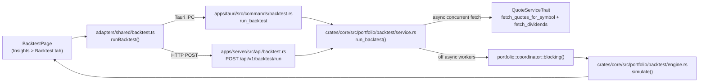

# Backtest Lab Design (v1)

- **Date:** 2026-11-22
- **Status:** Implemented (v1) — PR #44 (`feat/backtest-experiment-tab`)
- **Primary paths:**
  - Core engine & service: `crates/core/src/portfolio/backtest/`
  - Tauri command: `apps/tauri/src/commands/backtest.rs`
  - Web API route: `apps/server/src/api/backtest.rs`
  - Frontend adapter & types: `apps/frontend/src/adapters/shared/backtest.ts`,
    `apps/frontend/src/lib/types/backtest.ts`
  - Frontend UI: `apps/frontend/src/features/backtest/`
  - E2E coverage: `e2e/backtest.spec.ts`

## 1. Motivation & Goals

Wealthfolio already provides historical performance analysis, holdings
breakdowns, and market-data integrations. Users exploring asset-allocation
adjustments often want to answer practical "what-if" questions before changing
their portfolio:

- How would a 60/40 or three-fund portfolio have behaved under quarterly vs.
  drift-band rebalancing?
- What is the impact of reinvesting dividends (DRIP) versus accumulating them as
  cash?
- How does adding recurring dollar-cost averaging (DCA) change total return and
  ending value?
- How do simple, transparent tactical overlays (such as a 200-day SMA trend
  filter or monthly dual-momentum rotation) compare against Buy & Hold and a
  benchmark like `SPY`?

**Design goals for v1:**

1. **Portfolio-level experimentation, not quant scripting:** Focus on five
   well-understood allocation, rebalancing, and rule-based strategies that
   everyday investors actually evaluate.
2. **One-click connection to real holdings:** Let users seed an experiment from
   their current open, market-priced USD holdings or start from common US
   presets.
3. **Total-return realism without disturbing portfolio accounting:** Incorporate
   cash dividend events via existing market-data provider capabilities without
   altering stored `quotes` rows or portfolio valuation logic.
4. **Zero persistence blast radius:** Run stateless, in-session experiments with
   no database migrations and no writes to real assets, quotes, or activities.
5. **Dual-runtime & localization parity:** Work identically in Tauri desktop and
   self-hosted Web builds, across all 11 supported locales and right-to-left
   (`rtl`) layouts.

## 2. Scope & Explicit Non-Goals

### In Scope (v1)

- **Market & currency:** US-listed, USD-denominated securities (1–10 tickers per
  experiment, plus optional benchmark and optional defensive ticker).
- **Market data:** On-demand historical daily close quotes and cash dividend
  events fetched through existing configured providers (including tickers not
  currently held in the user's database).
- **Strategies:**
  1. Buy & Hold
  2. Periodic Rebalance (monthly, quarterly, semiannually, annually)
  3. Drift-Band Rebalance (rebalance when any asset or cash drifts by $\ge \pm
     X\%$ from target)
  4. SMA Trend Filter ($N$-day moving average with daily or monthly signal
     checks, rotating risk-off slices to a defensive ticker or USD cash)
  5. Momentum Rotation (top-$N$ by $L$-day trailing return on a fixed cadence,
     equal or inverse-volatility weighting, optional absolute-momentum filter to
     a defensive ticker or USD cash)
- **Cash flows & costs:** Initial capital, optional recurring DCA (biweekly,
  monthly, quarterly, annually), dividend mode (`reinvest`, `cash`, `exclude`),
  and optional trading fee drag in basis points (0–500 bps).
- **Persistence:** In-session only (React state + React Query 5-minute cache
  keyed by request).

### Deferred (v2+)

- Non-USD / multi-currency backtests with daily FX conversion and cross-market
  holiday alignment.
- Persisting and syncing named experiments in SQLite.
- Tax-lot and capital-gains drag modeling.
- Intraday bars, bid-ask spread modeling, or custom formula/scripting languages.

## 3. Architecture & Data Flow

### Key Architectural Boundaries & Invariants

- **No persistence side effects:** `run_backtest` never writes to SQLite
  (`assets`, `quotes`, `activities`, or `projection_state`) and introduces zero
  database migrations.
- **Provider settings preserved:** All quote and dividend fetches go through
  `QuoteServiceTrait`, respecting enabled/disabled providers and priority
  ordering (disabled providers receive zero requests).
- **Async worker safety:** After async network fetches complete, the pure
  simulation loop runs inside `crates/core/src/portfolio/coordinator::blocking`,
  matching Wealthfolio's rule for history-sized portfolio computations.
- **Failure isolation:**
  - If a provider does not support dividends or dividend lookup fails for a
    ticker, the backtest degrades gracefully to price return for that ticker and
    surfaces a user-visible warning in `response.warnings`.
  - If an optional benchmark fails to fetch or has insufficient history, the
    benchmark series is omitted with a warning instead of failing the user's
    experiment.
  - Non-USD required tickers fail fast with a `ValidationError::InvalidInput`
    (`400 Bad Request` on Web).

## 4. Simulation Semantics

### 4.1 Calendar Alignment & Indicator Warmup

- Required symbols (universe assets plus optional defensive asset) are aligned
  onto the union of observed trading days within their common overlapping range
  `[max(first_date), min(last_date)]`, forward-filling rare single-day gaps from
  the prior valid close. History is never fabricated before a security's first
  available quote.
- For indicator strategies (`SmaTrendFilter` and `MomentumRotation`),
  `service.rs` automatically fetches additional lookback history prior to
  `start_date` (`warmup_trading_days * 7/5 + 45` calendar days) so moving
  averages and trailing returns are warmed up on day 1 of the requested window.
- If available history cannot cover `start_date` plus warmup,
  `effective_start_date` is shifted forward to the earliest valid trading day
  and a warning is returned.

### 4.2 Zero-Lookahead Daily Execution Loop

On each trading day $t$ in `[effective_start_date, effective_end_date]`:

1. **Dividends (`t > 0`):** For each held position with an ex-dividend event on
   day $t$, credit `shares[i] * dividend_per_share`:
   - `reinvest`: buy additional shares of asset $i$ at day $t$'s close (DRIP).
   - `cash`: add to USD cash (deployed on the next rebalance; held as cash in
     Buy & Hold).
   - `exclude`: ignore dividend events.
2. **Mark-to-market & TWR update:** Value existing positions and cash at day
   $t$'s close _before_ external contributions and trades. Update the daily
   Time-Weighted Return (TWR) index from day $t - 1$'s post-trade value to day
   $t$'s pre-flow value so DCA inflows never distort return or risk metrics.
3. **Scheduled DCA contribution (`t > 0`):** On scheduled contribution dates,
   add the configured USD amount to cash and cumulative invested capital.
4. **Signal evaluation & trading:** Evaluate strategy rules strictly using
   prices available on or before day $t$:
   - If a rebalance/rotation triggers, compute gross traded notional
     $\sum_i |\text{target}_i - \text{current}_i|$, deduct
     `gross_traded * (fee_bps / 10_000)`, update shares and cash at day $t$'s
     close, and record turnover and fee drag on day $t$'s TWR.
   - If no rebalance triggers on a DCA day, deploy only the new contribution
     into the currently active target weights without selling existing holdings.

### 4.3 Why Explicit Dividend Events Instead of `quotes.adjclose`

In `crates/core/src/quotes/client.rs`, stored `Quote.adjclose` defaults to
`close` (split-adjusted on Yahoo, not dividend-adjusted). Using
`QuoteServiceTrait::fetch_dividends` (already backed by Yahoo, Finnhub, and
Alpha Vantage with provider fallback) avoids mutating global quote storage
semantics and enables explicit user control over `reinvest`, `cash`, and
`exclude` dividend behavior.

### 4.4 Strategy Definitions

- **Buy & Hold:** Invest initial capital into target weights on day 0; never
  sell to rebalance. Subsequent DCA inflows buy into the initial target weights.
- **Periodic Rebalance:** Rebalance back to target weights on the first trading
  day of each new calendar period (month, quarter, half-year, or year).
- **Drift-Band Rebalance:** Check daily weights; whenever any asset's weight or
  cash share deviates from target by at least `threshold_pct` percentage points,
  rebalance the full portfolio to target weights.
- **SMA Trend Filter:** On day 0 and each check date (`daily` or `monthly`),
  compare each asset's close against its trailing `sma_days` simple moving
  average. Assets above SMA keep their target slice; assets at or below SMA
  redirect their slice to `defensive_symbol` (or USD cash). Under `daily`
  checks, trades execute only when a trend signal flips to avoid daily
  micro-rebalancing noise.
- **Momentum Rotation:** On day 0 and each rebalance boundary, rank universe
  assets by trailing `lookback_days` total return (using dividend-reinvested
  virtual series when dividends are enabled) and select the top `top_n` assets.
  Allocate `equal` or `inverseVolatility` (63-day realized volatility) weights.
  When `absolute_momentum` is enabled, any selected leader with trailing return
  $\le 0\%$ redirects its slice to `defensive_symbol` (or USD cash).

### 4.5 Metrics

All risk and annualized return metrics are derived from the daily **TWR** series
so recurring DCA inflows do not inflate volatility or mask drawdowns:

- **Final Value, Total Invested, Net Profit, Total Return:** Money-on-money
  outcome `(final_value - total_invested) / total_invested`.
- **TWR & CAGR:** Cumulative TWR and annualized TWR over elapsed calendar years
  (`365.25` days/year).
- **Volatility, Sharpe, Sortino:** Annualized ($\times \sqrt{252}$) daily TWR
  standard deviation, Sharpe ratio (0% risk-free rate), and Sortino ratio (0%
  target return).
- **Max Drawdown:** Worst peak-to-trough decline on the TWR index, including
  peak, trough, and recovery dates.
- **Annual Returns, Best/Worst Year, Dividends, Fees, Rebalances, Annualized
  Turnover:** One-way turnover (`0.5 * gross_traded / equity`) annualized across
  the effective window.

## 5. UI & Localization Design

- **Location:** Added as the `backtest` tab in `PortfolioInsightsPage`
  (`apps/frontend/src/pages/insights/portfolio-insights.tsx`) between
  `Performance` and `Income`.
- **Configuration workflow:**
  - Preset bar (60/40 Classic, Three-Fund Drift, All-Weather, 200-Day SMA Trend,
    Dual Momentum) + **Import USD Holdings** button (`extractUsdHoldingsWeights`
    filters open, market-priced USD holdings and normalizes up to top 10 weights
    to 100%).
  - Asset builder powered by `TickerSearchInput` (`hideCustomCreate`), weight
    inputs, and one-click **Equalize**.
  - Strategy selector dynamically rendering only the parameters relevant to the
    active strategy.
  - Client-side localized validation (`noValidate` on `<form>` with
    `AlertFeedback`) backed by identical server-side validation.
- **Results dashboard:**
  - Growth chart (`USD Value` / `TWR %` toggle, overlaying Strategy, Buy & Hold
    baseline, Benchmark, and dashed `Total Invested` line when DCA is active),
    Drawdown underwater chart, and Calendar-Year Returns bar chart.
  - Headline KPI cards, full comparison table, ending allocation table,
    market-data coverage table, simulation warnings banner, and methodology
    disclaimer.
- **Localization & RTL:** Dedicated `backtest` namespace across all 11 supported
  locales (`en`, `ar`, `de`, `es`, `fr`, `it`, `ja`, `ko`, `pt`, `zh`,
  `zh-Hant`), CLDR plural forms, logical CSS utilities (`ms-`, `me-`, `ps-`,
  `text-end`), and formatting via `@wealthfolio/ui` hooks.

## 6. Verification & Limitations

- **Rust unit tests (`crates/core/src/portfolio/backtest/`):** Verify exact Buy
  & Hold return/drawdown, DRIP vs. Cash vs. Exclude dividends, drift-band
  rebalancing, DCA TWR isolation, lookahead-free SMA exits, momentum rotation +
  absolute momentum, non-USD rejection, and dividend/benchmark failure
  isolation.
- **Adapter & i18n checks:** `adapter-command-parity.test.ts` (Tauri/Web
  parity), `i18n:check`, and locale tests (`arabic.test.ts`,
  `traditional-chinese.test.ts`, `pluralization.test.ts`).
- **Playwright E2E (`e2e/backtest.spec.ts`):** Runs against the real built web
  app and Rust `wealthfolio-server` with synthetic fixtures, exercising API
  strategies, non-USD rejection, full UI workflow, and `?dir=rtl` desktop/mobile
  layout with zero horizontal overflow.
- **Known v1 limitation:** Automated tests use stubbed/fixture market data
  rather than live Yahoo/Finnhub/Alpha Vantage HTTP endpoints.

## 7. Future Directions (v2+)

1. **Saved experiments:** Local SQLite persistence for naming, saving, and
   comparing multiple strategy runs side by side.
2. **Multi-currency support:** Convert non-USD tickers into base currency via
   existing `FxService` historical rates.
3. **Allocation Target integration:** One-click "Backtest this target" entry
   point from Allocation Targets.
4. **Tax & inflation options:** Optional dividend withholding tax, capital-gains
   drag on rebalancing, and CPI-adjusted real returns.
